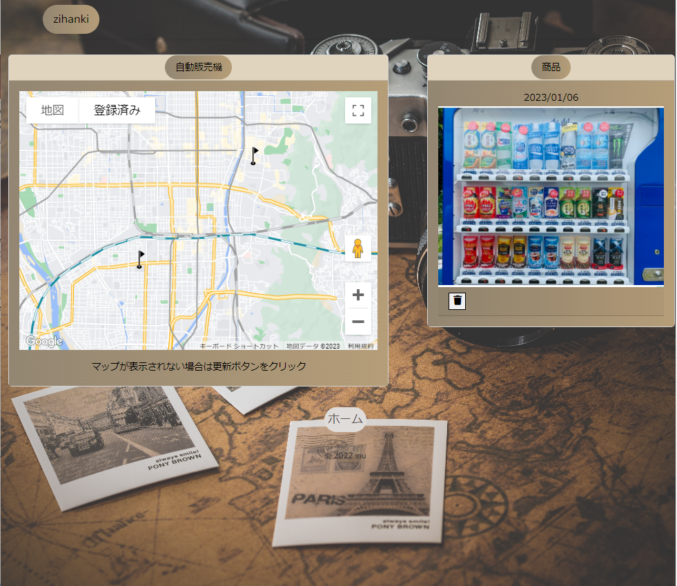

# 自販機マップ (zihanki)

自動販売機の位置を地図上にピンで登録し、写真を表示する Web アプリです。
学生時代（2022年11月〜2023年2月）に Laravel の学習を兼ねて制作しました。



> このアプリを FastAPI + React + TypeScript で作り直した新しい版は、[zihanki_v2](https://github.com/youtatata/zihanki_v2) リポジトリで公開しています。

## 制作の経緯

学生時代に遊びに出かけた際、ふと飲み物が欲しくなり、近くの自動販売機の場所を知りたくなりました。Coke ON のように大手メーカーの自販機には専用アプリがあり、その場所はわかりました。ただ、自動販売機にはほかにも多くの種類があり、それらの場所はわかりませんでした。

そこで、ユーザー同士で情報を持ち寄り、自動販売機の位置がわかり、登録された写真を見れば売っている商品もわかるアプリがあれば便利だと考え、制作しました。

## 制作について

- **制作形態**：個人制作（1人で企画・開発）
- **苦労したこと**：授業では PHP で簡単な掲示板を作った程度の経験しかありませんでした。フレームワーク（Laravel）や API の考え方など、初めて使う技術ばかりで、学習しながらの制作になり苦労しました。
- **学んだこと**：自分で考えたシステムが実際に動いたときに、アプリを作る楽しさを知りました。
- **やり残したこと**：このアプリは、実際にユーザーに使ってもらって初めて価値が出るものです。しかし当時はローカル環境での実装までにとどまり、サーバーを用意して実際に使ってもらうところまでは進められませんでした。

## 主な機能

| 画面 | URL | 内容 |
|---|---|---|
| ホーム | `/` | 登録済みのピンを地図に表示し、ピンを選ぶと写真を表示 |
| 追加 | `/create` | 地図中央の位置に、写真付きでピンを登録 |
| 編集 | `/editing` | 登録済みのピンを選んで削除 |

## 使用技術

- PHP 8 / Laravel 9（laravel/ui による Bootstrap）
- MySQL
- Google Maps JavaScript API

## セットアップ

```bash
composer install
npm install

cp .env.example .env
php artisan key:generate
```

`.env` に、データベースの接続情報と Google Maps の API キーを設定します。

```
DB_DATABASE=...
DB_USERNAME=...
DB_PASSWORD=...
GOOGLE_MAPS_API_KEY=...
```

API キーは Google Cloud Console で発行し、Maps JavaScript API を有効にしてください。キーはコードに直接書かず、`.env` から読み込みます（`config/services.php`）。

```bash
php artisan migrate
php artisan storage:link   # 登録した写真を表示するため
```

## 起動

```bash
npm run dev
php artisan serve
```

ブラウザで http://localhost:8000 を開きます。
